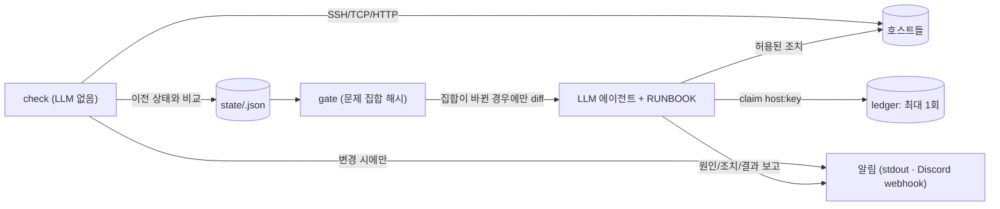

# self-healing-homelab-monitor

[English](README.md) | 한국어

홈랩 상태를 **결정론적 스크립트로 점검**하고, **상태가 바뀔 때만 알림**을 보내며,
**문제 집합이 바뀔 때만** LLM 복구 에이전트를 깨우는 구조입니다. 에이전트는
*허용 작업* / *먼저 물어볼 작업*이 명시된 런북을 따르고, 같은 문제에 대한 조치는
최대 한 번만 시도합니다.

> 제가 실제 홈랩(Proxmox 서버와 여러 VM, Windows 데스크톱, 노트북)에서 운영 중인
> 시스템을 일반화·비식별화한 공개용 버전입니다. 호스트명, 주소, 계정, 키, VM ID,
> 채널 ID는 모두 예시 값이 들어간 설정 파일로 대체했습니다.

## 해결하려는 문제

- **너무 시끄러움**: 5분마다 결과를 다 올리면 채널을 안 보게 됩니다.
- **너무 비싸거나 위험함**: 매 점검마다 LLM을 부르면 호스트당 하루 288번 토큰을
  쓰고, 규칙 없는 셸 권한 에이전트는 언젠가 재부팅으로 "해결"합니다.

목표: 점검은 공짜이고 지루하게, 알림은 드물고 의미 있게, 에이전트는 새로운 상황에서만
좁고 문서화된 권한으로.

## 아키텍처



### 흐름: 점검 → 비교 → 알림 → 게이트 → 에이전트 → 보고

1. **점검**: 호스트별 설정된 체크 실행. 결과를 `svc:web-app`, `vm:101` 같은 키로 표현.
   "알 수 없음"(점검 도구 자체 실패)은 상태를 만들지도 지우지도 않음.
2. **비교**: 첫 실행은 조용히 기준선 저장, 새 문제는 2회 연속 관측 시 보고(플랩 방지,
   `immediate`는 예외), 사라지면 "복구" 1회, 문구만 바뀐 건 새 이벤트 아님, 야간에는
   비긴급 이벤트를 보류 후 아침에 전송. 상태 파일은 원자적으로 기록.
3. **알림**: 이벤트가 있을 때만 전송. 긴급이면 소유자 멘션. 웹훅 URL/사용자 ID는 환경변수.
4. **게이트**: 모든 상태 파일의 `host:key` 집합을 정렬·정규화 후 SHA-256 해시.
   이전과 같으면 출력 없음 → 에이전트 호출 없음.
5. **에이전트**: diff를 입력으로, `RUNBOOK.example.md`를 지시문으로 받음. 조치 전
   `claim` 필수, 24시간 내 두 번째 claim은 종료코드 3 → 소유자에게 질문.
6. **보고**: 문제당 한 번, 원인/조치/결과를 소유자 멘션으로 전송.

## 안전 모델

- 장애 판단은 결정론적 스크립트가 함 (모델이 판단하지 않음).
- 허용 목록: 설정된 서비스 1회 재시작, 정지된 VM 시작, 폭주 프로세스 종료,
  재생성 가능한 캐시 정리, 주간 Wake-on-LAN.
- 먼저 물어볼 것: 재부팅, 설정 변경, 캐시 외 삭제, 디스크 SMART 경고, 반복 장애, 불확실한 모든 것.
- 문제당 최대 1회 조치를 원장(ledger)으로 강제.
- 비밀값은 설정 파일·출력에 넣지 않음. CI에서 gitleaks 실행.

## 비용 모델

점검은 호스트당 하루 288회지만 토큰 0. LLM은 문제 **집합**이 바뀔 때만 실행되며,
조용한 날은 0회, 장애 하나당 보통 2회(발생·복구)입니다.

## 실행

```bash
python -m venv .venv && . .venv/bin/activate
pip install -e ".[dev]"
pytest -q
python demo/local_demo.py      # Docker 없이 로컬 데모
docker compose up --build      # 가짜 대상 컨테이너 + dry-run 모니터
```

## 실제 운영 버전과의 차이

- 실제: Windows PowerShell 지표, Proxmox 저장소/SMART/게스트 서비스 점검, 호스트 채널별
  실시간 상태 임베드(Discord 봇, 한국어), Hermes Agent 크론. 이 저장소: YAML 기반 범용
  체크, 웹훅/stdout, 프레임워크 비의존 CLI.
- 실제 버전은 VM 자동 시작을 모니터가 30분 쿨다운으로 직접 수행. 여기서는 claim 뒤 에이전트로 이동.
- 테스트/CI/데모는 공개 버전에서 새로 추가.

## 한계

- 단일 스케줄러, 이력·대시보드 없음 (Prometheus, Uptime Kuma 등과 대체 관계가 아님).
- 런북은 지시문 + claim 원장으로 강제되며, 셸 샌드박스는 아님 → 최소 권한 사용자로 실행 권장.
- Docker 데모는 CI(GitHub Actions의 `docker-demo` 작업)에서 실행되며, 실제 호스트에 대해서는 실행하지 않았습니다.

## 역할

시스템 설계·운영 규칙 결정·실제 운영은 제가 했고, 코드는 AI 코딩 에이전트로 구현한 뒤
제가 검토했습니다. 공개 버전은 테스트와 로컬 데모로 검증했으며 실제 호스트에 대해 실행하지는 않았습니다.

## 라이선스

MIT © lUbY
