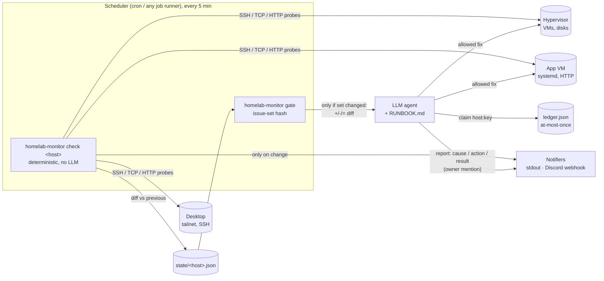

# self-healing-homelab-monitor

English | [한국어](README.ko.md)

Deterministic homelab health checks that alert **only when something changes**,
plus an **issue-set gate** that wakes an LLM remediation agent **only when the
set of problems changes**. The agent follows a written runbook with explicit
*allowed* and *ask-first* actions and may attempt each fix at most once.

> This repository is a sanitized, generalized version of a system I run on my
> own homelab (a Proxmox server with several VMs, a Windows desktop and a
> laptop). Hostnames, addresses, users, keys, VM IDs and channel IDs have been
> replaced by a config file with placeholder values.

## Problem

Homelab monitoring tends to fail in one of two ways:

- **Too noisy.** A check every 5 minutes that posts every result trains you to
  ignore the channel.
- **Too expensive / too risky to automate.** Putting an LLM agent in the loop on
  every check burns tokens 288 times a day per host, and an agent with shell
  access and no rules will eventually "fix" something by rebooting it.

The design goal: checks are free and boring, notifications are rare and
meaningful, and the agent is woken only for new situations, with a narrow,
written mandate.

## Architecture



### Flow: check → diff → notify → gate → agent → report

1. **Check.** `homelab-monitor check <host>` runs the host's configured checks
   (`tailscale_online`, `ssh_reachable`, `tcp`, `http`, `systemd_units`,
   `proxmox_vms`, `disk_usage`, `command`). Each yields a set of conditions
   keyed like `svc:web-app` or `vm:101`. Probe failures that mean "I don't
   know" (e.g. the tailnet CLI itself failed) return *unknown* and never create
   or clear conditions.
2. **Diff.** The condition set is compared with the host's state file:
   - first run = silent baseline;
   - a new condition must appear on 2 consecutive runs (anti-flap) unless it is
     marked `immediate` (e.g. hypervisor unreachable);
   - a reported condition that disappears yields one "recovered" event;
   - text changes (91% → 92%) are not new events;
   - in quiet hours non-urgent events are held and flushed in the morning.
   State is written atomically (temp file + rename).
3. **Notify.** Notifiers are called only when there are events. Urgent events
   mention the owner. The Discord webhook URL and owner ID come from
   environment variables; `allowed_mentions` blocks `@everyone`/role pings.
4. **Gate.** `homelab-monitor gate` reads all state files, builds the set of
   `host:key` identities and hashes it (SHA-256 over sorted canonical JSON).
   If the hash equals the last one, output is empty and nothing else happens.
   Otherwise it prints a `+`/`-`/`=` diff and records the new hash, so each
   change is delivered once.
5. **Agent.** Whatever runs on a non-empty gate (an LLM agent, or a plain
   script) gets the diff as input and [`RUNBOOK.example.md`](RUNBOOK.example.md)
   as instructions. Before acting it must `homelab-monitor claim host:key`;
   a second claim within 24h exits with code 3 → ask the owner instead.
6. **Report.** `homelab-monitor report <host> "Cause / Action / Result"` sends
   one owner-mention message per handled issue. Adding
   `--issue host:key --action "..." --result fixed|failed|escalated` also
   records the outcome for metrics (the plain form still works unchanged).

## Measurement: event log and metrics

Every state change the monitor *reports* and every remediation is appended to
`<state_dir>/events.jsonl` (one JSON object per line, file mode 0600,
`O_APPEND` + `fsync`):

| Event | Written by | Notes |
|---|---|---|
| `issue_opened` | `check`, when a key enters the reported set (after anti-flap) | `seed: true` for the silent first-run baseline |
| `issue_resolved` | `check`, when a reported key disappears | |
| `remediation` | `claim` (`result: claimed` / `refused`) and `report --result` (`fixed` / `failed` / `escalated`) | `source` says which |

Timestamps follow the reported set, not notification delivery, so quiet-hours
holding does not distort detection time. Logging is best effort: a failed
write prints a warning to stderr and the check/claim carries on.

`homelab-monitor metrics [--since 7d|24h|30m|all] [--json]` is read-only and
pairs each open with the next resolve of the same `host:key`:

- opened / resolved counts per issue, issues still open
- time to resolve: median and p90 (linear interpolation)
- remediation events by result and by `source:action`
- MTTR split: episodes with a `fixed` remediation (reported between the open
  and the next open of that issue) vs. without
- seeded opens are excluded from counts and timing (their real start is unknown)

Example output from a **synthetic** event set (illustrative only):

```text
Homelab monitor metrics (all time)
- events recorded: 14
- issues opened: 4 | resolved: 4
  - app:disk:/: opened 1 / resolved 1
  - app:svc:web: opened 1 / resolved 1
  - nas:offline: opened 1 / resolved 1
  - pve:vm:101: opened 1 / resolved 1
- time to resolve (n=4): median 32m | p90 2h 15m
- remediation events: 6 (claimed 3, escalated 1, fixed 2)
  - claim:clean cache: 1
  - claim:restart web: 1
  - claim:start vm: 1
  - report:clean cache: 1
  - report:restart web: 1
  - report:start vm: 1
- MTTR with a fixed remediation: mean 8m | median 8m (n=2)
- MTTR without: mean 1h 52m | median 1h 52m (n=2)
```

These are not numbers from my homelab. The private deployment has the same
event log, but its measurements are not published here.

See [`docs/agent-adapter.md`](docs/agent-adapter.md) for how to wire this to
cron + any CLI agent, to an agent framework's scheduled job, or to no LLM at
all.

## Safety model

- **Detection is deterministic.** No model decides whether something is broken.
- **The agent's mandate is a whitelist.** Allowed without asking: restart a
  configured service once, start a stopped configured VM, kill clearly runaway
  processes, clean regenerable caches, send Wake-on-LAN during daytime.
  Everything else (reboots, config changes, deletion beyond caches, hardware
  warnings, anything repeating) is **ask first**.
- **At most once per issue, mechanically.** The ledger makes "don't retry a
  failed fix" a property of the tooling, not just of the prompt.
- **Secrets stay out of config and output.** Webhook URLs and user IDs come
  from env vars; SSH uses `BatchMode=yes` and `StrictHostKeyChecking=yes`.
- **Unknown is not healthy and not broken.** Probe failures don't generate
  false recoveries.
- CI runs gitleaks on every push.

## Cost model

| Component | Frequency | Cost |
|---|---|---|
| Checks | every 5 min per host (288/day) | CPU + a few SSH/HTTP calls; no tokens |
| Notifications | on state change only | free (webhook) |
| Gate | every 5 min | reads a few JSON files |
| LLM agent | only when the issue **set** changes | typically 0 runs on a quiet day; ~2 per incident (appear, recover) |

Alert text changing (disk 91% → 92%) does not wake the agent, because the
gate hashes issue identity, not wording.

## Quick start

```bash
python -m venv .venv && . .venv/bin/activate
pip install -e ".[dev]"
pytest -q                          # 70 tests, all with fakes (no SSH/network)
python demo/local_demo.py          # docker-free walkthrough on 127.0.0.1

cp config.example.yaml config.yaml          # edit hosts/checks
cp RUNBOOK.example.md RUNBOOK.md            # edit allowed actions
homelab-monitor check all --dry-run
homelab-monitor gate --peek
homelab-monitor metrics --since 7d
```

Docker demo (fake target container + monitor in dry-run mode):

```bash
docker compose up --build
docker compose stop target    # problem appears after 2 cycles, gate prints a diff
docker compose start target   # recovered
```

Cron example:

```cron
*/5 * * * *  cd /opt/monitor && .venv/bin/homelab-monitor check all
*/5 * * * *  cd /opt/monitor && sleep 30 && PATH=.venv/bin:$PATH ./examples/wake-agent.sh
```

## Repository layout

```
homelab_monitor/   config.py  checks.py  state.py  gate.py  notify.py  ledger.py  events.py  metrics.py  cli.py
tests/             config, state diffing, gate hashing, notify, checks/CLI, event log + metrics (fakes only)
demo/              docker + local demo configs, local_demo.py
docs/              agent-adapter.md
examples/          wake-agent.sh
RUNBOOK.example.md config.example.yaml docker-compose.yml Dockerfile
```

## What's in the real deployment vs. this repo

| | Real deployment (private) | This repo |
|---|---|---|
| Hosts | Proxmox host + VMs, Windows desktop via SSH/PowerShell, laptop via tailnet presence | Generic check types driven by YAML |
| Windows metrics | CPU/memory/disk via encoded PowerShell over SSH | Not included (use `command` check via SSH) |
| Proxmox extras | storage pools, SMART health, guest-agent service checks inside VMs, memory/IO pressure of the agent VM | `proxmox_vms`, `disk_usage`, `systemd_units`; the rest is left out |
| Notifications | Discord bot: one live status embed per host channel (edited in place) + owner-mention messages, in Korean | Discord webhook + stdout, English, plain messages |
| Scheduler/agent | Hermes Agent cron jobs (script-only, no LLM) + a gated agent job | Framework-agnostic CLI contracts |
| VM auto-start | Done by the monitor itself with a 30-minute cooldown | Moved to the agent behind `claim` |
| At-most-once | Runbook instruction + cooldown | Same rule, enforced by a ledger |
| Event log / metrics | `events.jsonl` + a metrics script (Korean output); auto VM starts logged as remediations | `events.jsonl` + `metrics` subcommand (English); remediations come from `claim` / `report --result` |
| Tests / CI / demo | None (personal script) | 70 pytest tests, ruff, gitleaks, docker + local demo |

## Limitations

- Single-node scheduler; no HA, no dashboards. The event log gives incident
  metrics (time to resolve, remediation outcomes), not time-series history. For that, use
  Prometheus/Alertmanager, Uptime Kuma, Netdata, etc. This project is about the
  *gate + runbook-driven remediation* pattern, not about replacing them.
- The ledger and state files assume one writer at a time (cron runs don't overlap).
- MTTR "with vs. without a fixed remediation" is a correlation over few
  episodes, not a controlled comparison; small `n` is shown next to every number.
- The runbook is enforced by the agent's instructions plus the claim ledger;
  the tooling does not sandbox the agent's shell. Run the agent as a
  least-privilege user with sudo rules scoped to the allowed actions.
- The Docker demo runs in CI (`docker-demo` job, GitHub Actions); it has not
  been run against real hosts.

## Role and how it was built

I designed this system, run it on my own homelab, and define its operating
rules (what may be automated, what must be asked). The code — both the private
original and this public generalization — was implemented with AI coding
agents under my direction and reviewed by me. The private original runs on my
homelab; this public version is verified by its test suite and the local demo,
not by running it against my real hosts.

## License

MIT © lUbY
